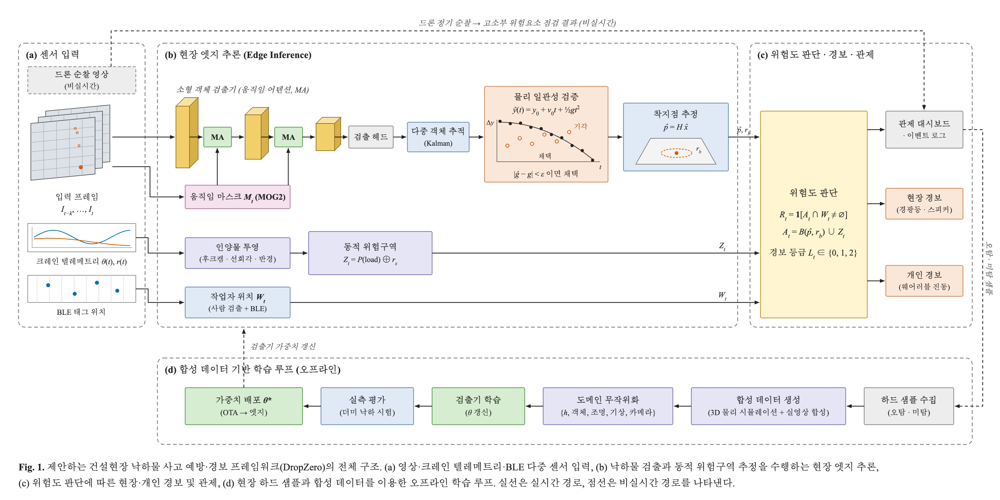
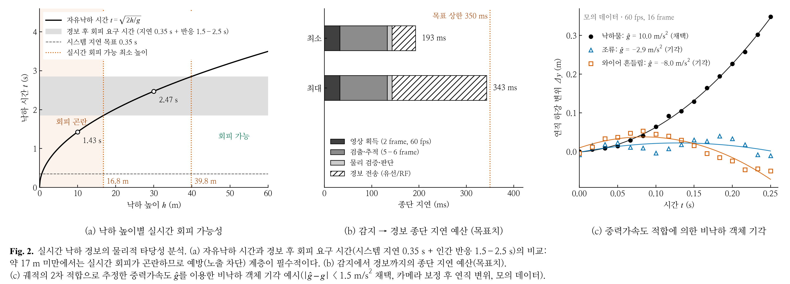
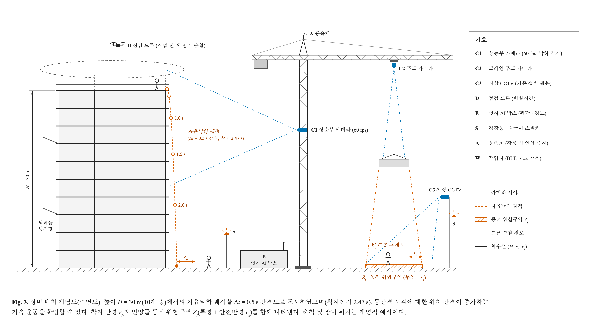
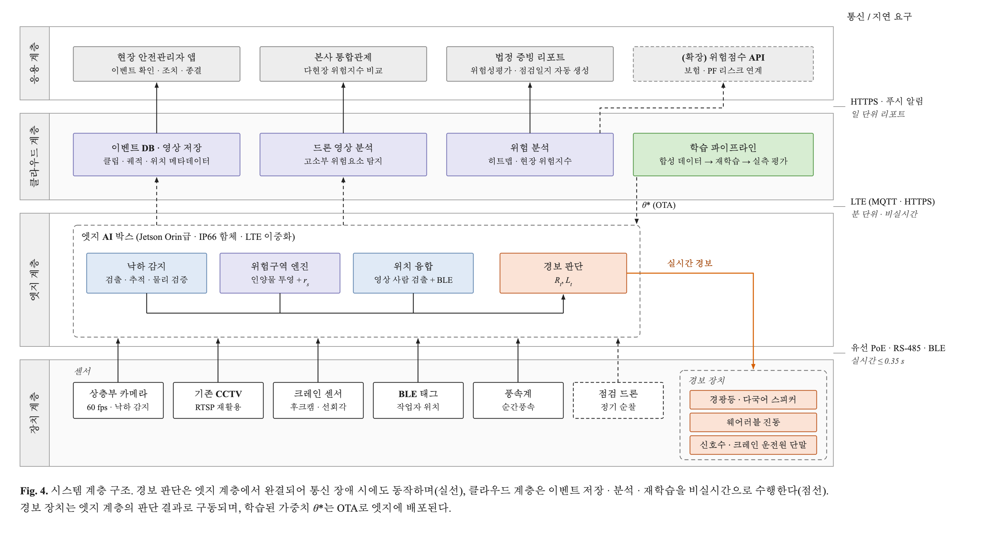
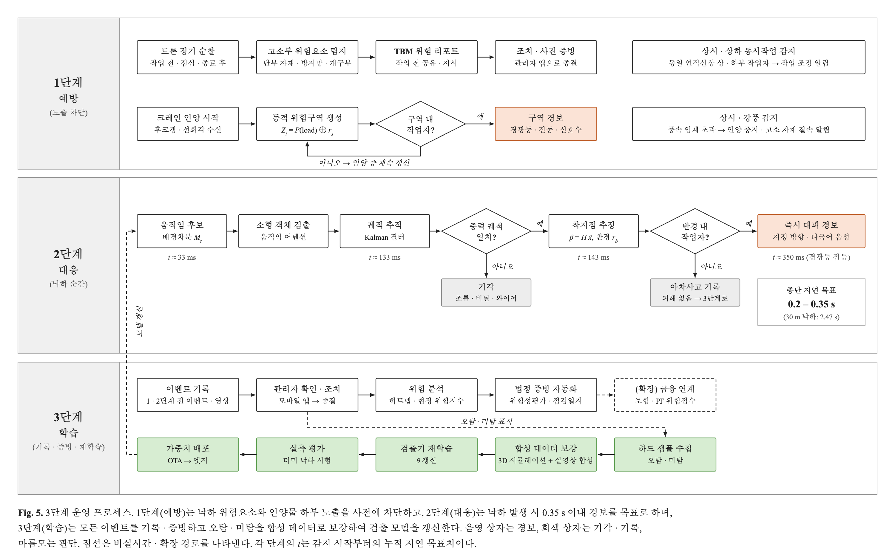

# 사업 아이디어 고도화 — 건설현장 낙하물 사고 AI 예방·경보 플랫폼 (가칭 DropZero)

> 원안: 건설사 대상 / 드론 + CCTV로 낙하물 판별 / 하드웨어 경보 / 관제 / 합성 데이터
> 고도화 방향: **"떨어지는 순간을 잡는다" → "맞을 수 있는 상황을 먼저 없애고, 떨어지면 알리고, 모든 낙하를 데이터로 남긴다"**
> 작성일 2026-10-29. 수치 출처는 문서 끝 [참고자료](#참고자료). `(추정)` 표시는 검증 전 가정.

## 도면

> 원본 SVG(수정용)와 PNG(사업소개서용)는 `docs/diagrams/`에 있다. 문구를 바꾸려면 `build.py`를 고치고 `python3 docs/diagrams/build.py`를 실행한다.







---

## 1. 문제 — 왜 낙하물인가

| 지표 | 수치 |
|------|------|
| 2025년 재해조사 대상 사고사망자 | **605명** (전년 589명, 3년 만에 증가) |
| 그중 건설업 | **286명 (47%)** |
| 사고 유형 1위 / 2위 | 떨어짐 249명(41.2%) / **물체에 맞음 72명(11.9%)** |
| 5억 미만 소규모 건설현장 사망 | 전년 대비 +25명 |

- "물체에 맞음"(구 명칭 낙하·비래)은 사망 유형 2위다. 그런데 기존 AI CCTV는 안전모 미착용, 침입, 화재, 쓰러짐 감지에 몰려 있고, **낙하물만 끝까지 다루는 솔루션은 사실상 없다.**
- 중대재해처벌법이 5인 이상 사업장 전체로 확대됐다. 건설사는 "안전보건관리체계를 실제로 운영했다"는 **증빙**이 필요하다.
- 낙하 사고는 사람이 맞지 않으면 기록이 남지 않는다. 그래서 위험한 현장인지 아닌지 데이터로 판단할 근거가 없다(아차사고가 사라짐).

## 2. 현실성 점검 — 원안의 약점 3가지

### 2-1. 물리적 한계: 떨어지는 걸 보고 울리면 늦다

자유낙하 시간 `t = √(2h/g)` (공기저항 무시)

| 높이 | 대략 층수 | 낙하 시간 | 충돌 속도 |
|------|----------|-----------|-----------|
| 5 m | 2층 | 1.01초 | 36 km/h |
| 10 m | 3~4층 | 1.43초 | 50 km/h |
| 20 m | 7층 | 2.02초 | 71 km/h |
| 30 m | 10층 | 2.47초 | 87 km/h |
| 50 m | 17층 | 3.19초 | 113 km/h |

- 시스템 지연을 아무리 줄여도 0.2~0.35초가 걸린다(아래 4-3).
- 사람은 경보를 듣고 판단해서 1~2m 피하는 데 **약 1.5~2.5초**가 필요하다(추정).
- 결론: **실시간 회피 경보는 약 20m 이상 고층에서만 의미 있는 "마지막 방어선"**이다. 저층 낙하는 경보로 막을 수 없다.
- 그래서 사업의 무게중심을 **예방(노출 차단)**으로 옮긴다. 낙하물 사고는 결국 **"위에서 떨어질 수 있는 것 × 그 아래 있는 사람"**이다. 둘이 겹치지 않으면 낙하해도 사망사고가 나지 않는다.

### 2-2. 드론: 상시 감시용으로는 비현실적

- 배터리 30~45분, 강풍이 부는 고층부, 비행승인(관제권·비행금지구역), 야간·가시권 밖 비행은 특별비행승인이 필요하다.
- **드론 자체가 낙하물이다.** 작업자 머리 위 상시 비행은 심사위원이 바로 지적할 약점이다.
- → 드론은 **"하루 2~3회 정기 점검 순찰"**로 역할을 바꾼다. 작업 전(TBM 전), 점심시간, 작업 종료 후에 작업자가 없는 동선으로 외곽·상층부를 돈다. 고정 CCTV가 못 보는 **고소부 위험요소**를 찾는 역할이다.

### 2-3. 데이터: 실제 낙하 영상은 거의 없다

- 사고 영상은 희소하고, 낙하물은 화면에서 **중앙값 약 20픽셀** 크기에 모션블러까지 생긴다(FADE 데이터셋 기준).
- 공개 연구(FADE-Net)도 F1 72% 수준이라, 일반 객체탐지(RT-DETR F1 40%)로는 안 된다.
- → **합성 데이터 + 물리 기반 판별**이 기술 차별점이 된다(5장).

## 3. 솔루션 — 3단 방어 구조

```
 [1단 예방]  위에서 떨어질 것 찾기      ← 드론 정기순찰 + 상층부 CCTV
             그 아래 사람 막기           ← 인양물 동적 위험구역 + 침입 경보
 [2단 대응]  떨어지는 순간 감지 → 경보   ← 엣지 AI + 물리 궤적 판별 + 경광등/웨어러블
 [3단 학습]  모든 낙하를 아차사고로 기록 ← 위험 히트맵, 위험성평가·법정 증빙, 보험 연계
```

### 1단 — 예방 (핵심 가치, 물리 한계와 무관)

| 기능 | 내용 | 센서 |
|------|------|------|
| **인양물 동적 위험구역** | 타워크레인 인양 중 인양물 위치를 따라 바닥에 위험구역(인양물 투영 + 안전 반경)을 실시간 생성하고, 구역 안에 사람이 들어오면 경보 | 크레인 후크캠/충돌방지장치 데이터 + 지상 CCTV |
| **상하 동시작업 감지** | 같은 수직선상에서 위층 작업자와 아래층 작업자가 동시에 감지되면 경보 | 외벽 방향 CCTV |
| **고소부 위험요소 점검** | 단부 자재 적치, 안전난간·낙하물방지망 미설치/파손, 개구부 덮개 누락 탐지 → TBM 전 리포트 | 드론 정기순찰 |
| **기상 연동** | 강풍(순간풍속 기준) 시 고소 자재 결속 점검·인양 중지 알림 | 풍속계/기상 API |

### 2단 — 실시간 낙하 감지·경보 (고층 구간 보조층)

- 상층부를 향한 고정 카메라로 낙하 후보를 감지한다 → 궤적이 **중력가속도와 맞는지** 검증한다 → 착지점을 예측한다 → 착지 반경 안 작업자·구역에 경보를 보낸다.
- 경보 채널(여러 단계로 겹침):
  1. 구역 경광등 + 스피커: 하부 통로와 출입구. **다국어 음성**(외국인 근로자 대응)
  2. 웨어러블: 스마트 안전모·밴드 진동. BLE 위치 정보로 "누가 반경 안에 있는지"도 판별
  3. 신호수·크레인 운전원 알림
- 경보 문구는 "위를 보라"가 아니라 **"즉시 건물 안쪽/지정 방향으로 이동"**이다. 위를 쳐다보는 반사행동은 위험하다. 현장 교육과 함께 설계해야 한다.

### 3단 — 데이터·관제

- **현장 관제 대시보드 + 안전관리자 모바일 앱**: 이벤트 → 확인 → 조치 → 종결 워크플로
- 모든 낙하·침입 이벤트(사람이 안 맞은 것 포함)를 영상 클립과 함께 기록 → **현장 위험 히트맵**, 공종·협력사·시간대별 분석
- **법정 증빙 자동화**: 위험성평가 개선 이력, 안전점검 일지, 중대재해처벌법상 안전보건관리체계 이행 근거
- 본사 통합관제: 여러 현장 위험지수 비교

## 4. 기술 설계

### 4-1. 시스템 구성

```
[카메라: 기존 CCTV + 상층부 전용 60fps 카메라]   [크레인 데이터]   [드론 순찰 영상]
              │ RTSP                                │                    │ (사후 업로드)
              ▼                                     ▼                    ▼
        ┌──────────── 현장 엣지 박스 (Jetson Orin급) ────────────┐   ┌─ 클라우드 ─────────────┐
        │ 움직임 후보 → 소형객체 검출 → 추적 → 물리 판별      │──▶│ 이벤트 DB / 대시보드  │
        │ 사람·구역 판단 → 경보 결정 (클라우드 없이 동작)     │   │ 드론 영상 분석·리포트 │
        └───────────────┬──────────────────────────────────┘   │ 모델 재학습 파이프라인 │
                        │ 유선 / 전용 RF                         └────────────────────────┘
                        ▼
              [경광등·스피커]  [웨어러블]  [관리자 앱 푸시]
```

- **경보 판단은 반드시 엣지에서 한다.** 현장 LTE는 불안정하므로 클라우드 왕복을 거치면 수백 ms~수 초가 늦어진다.
- 기존 CCTV를 재활용해 도입비를 낮춘다(16층 이상 공동주택은 CCTV 설치가 이미 의무). 다만 낙하 감지 구간은 일반 CCTV(15~30fps, 고압축)로 20px 물체가 뭉개지므로 **전용 고프레임 카메라**를 둔다.

### 4-2. 낙하물 판별 파이프라인 (오경보 억제가 핵심)

1. **움직임 후보 추출**: 배경차분(MOG2)과 프레임 차분 → 작고 빠른 물체 후보
2. **소형객체 검출**: 움직임 마스크를 어텐션으로 쓰는 검출기(FADE-Net 방식 참고) + 고해상도 타일 추론
3. **추적**: 칼만필터/ByteTrack
4. **물리 일관성 필터 ← 차별점**: 카메라 캘리브레이션을 바탕으로, 궤적이 `y = y₀ + v₀t + ½gt²`에 맞는지 피팅한다.
   - 새, 비닐, 낙엽, 크레인 와이어 흔들림은 **탄도 궤적이 아니므로** 제거한다 → 오경보가 크게 줄어든다(가설, 검증 대상).
5. **착지점 예측**: 지면 호모그래피에 투영하고, 바운드·비산 반경을 마진으로 둔다
6. **경보 결정**: 착지 반경 ∩ (사람 검출 ∪ BLE 태그 위치) → 경보 등급

### 4-3. 지연 예산 (목표치)

| 단계 | 목표 |
|------|------|
| 캡처·디코딩 (60fps, 2프레임) | ~33 ms |
| 후보 검출 + 궤적 확정 (5~6프레임) | ~100 ms |
| 물리 판별·착지점·판단 | ~10 ms |
| 경보 전달 (유선/전용 RF) | 50~200 ms |
| **합계** | **약 0.2~0.35초** |

→ 30m 낙하(2.47초) 기준 약 2.1초가 남는다. 10m(1.43초)에서는 사실상 회피가 불가능하다. **이 표를 사업소개서에 그대로 넣는다.** 한계를 알고 1단 예방으로 설계했다는 점이 오히려 신뢰를 준다.

### 4-4. 핵심 KPI (파일럿에서 측정)

- **오경보율**: 카메라당 시간당 오경보 수. 오경보가 많으면 현장이 경보를 끈다(alarm fatigue). 재현율보다 우선 관리한다.
- 낙하 감지 재현율(높이·물체 크기별), 위험구역 침입 감지 정확도
- 종단 지연(감지 → 경광등 점등)
- 운영 지표: 이벤트 조치 완료율, 위험요소 리포트 반영률

## 5. 합성 데이터 전략

### 왜 필요한가
실제 낙하 영상은 극히 드물고, 사람에게 위험해서 재현할 수도 없다. 라벨링(20px, 블러)도 사람이 하기 어렵다.

### 파이프라인 (3층)

| 층 | 방법 | 용도 |
|----|------|------|
| ① 3D 시뮬레이션 | Unreal Engine 5 / NVIDIA Isaac Sim(Omniverse Replicator)에 건설현장 씬 구성, 강체 물리로 낙하 | 대량 학습 데이터 + 자동 라벨(bbox, 궤적, 착지점) |
| ② 실영상 합성 | **실제 현장 CCTV 배경**에 렌더링 낙하물을 물리 궤적 + 모션블러로 합성 | 도메인 갭 축소, 저비용 대량 생성 |
| ③ 실측 검증 | 통제된 환경(학교 건물·협력 현장)에서 더미 물체 낙하 실험 | **평가 전용 세트**(학습에 섞지 않음) |
| 보조 | FADE(2,611개 영상) 등 공개 데이터 | 베이스라인·사전학습 |

### 시나리오 카탈로그 ("여러 가지 상황")

| 축 | 랜덤화 범위 |
|----|------------|
| 낙하 원인 | 인양물 탈락(줄걸이 불량), 고소 작업자 공구 낙하, 단부 자재 강풍 비산, 거푸집 해체, 외벽(비계·곤돌라) 작업 |
| 물체 | 볼트·공구(소형), 벽돌·파이프(중형), 합판·거푸집 패널(판형: 펄럭이며 비정형 낙하) |
| 높이·카메라 | 3~100m, 카메라 높이·각도·화각·fps·셔터속도 |
| 환경 | 주간·야간(IR)·역광·비·안개·먼지 |
| **하드 네거티브** | 새, 비닐·천 조각, 크레인 와이어, 빗방울, 인양 중 정상 이동 자재 |

- 생성형 비디오 모델은 물리가 부정확하다. 그래서 낙하물 자체가 아니라 **배경·기상 다양화**에만 쓴다.
- 검증 지표: 합성 데이터만 쓴 모델 vs 합성+소량 실데이터 모델의 실측 세트 성능 차이(sim-to-real gap).

## 6. 고객과 비즈니스 모델

### 타깃
| 세그먼트 | 전략 |
|---------|------|
| **1차: 중견 건설사**(시공능력평가 약 30~200위), 고층 공동주택·오피스 현장 | 자체 플랫폼이 없고 중대재해 리스크가 크다. 16층 이상 현장은 CCTV 인프라가 이미 있다 |
| 2차: 대형 건설사 | 자체 통합관제가 있으므로 **낙하물 분석 모듈을 API로 공급** |
| 3차: 소규모 현장(50억 미만) | 정부 스마트 안전장비 지원사업을 통해 진입 |

### 과금
- **현장당 월 구독(SaaS) + 하드웨어 렌탈**: 공사기간 한정이라 구매보다 렌탈을 선호한다.
- 구매 장벽이 낮다:
  - 산업안전보건관리비(산안비)의 스마트 안전장비 구매·임대 인정비율이 **2026년부터 100%**다(고용노동부고시 제2024-53호). AI CCTV, 위험지역 접근경보, 드론 안전관측 장비가 인정 품목에 포함된다. 단, 산안비 내 사용한도가 있으니 고시를 확인해야 한다.
  - 안전보건공단 스마트 안전장비 지원사업: 도입비 최대 80%, 사업장당 최대 3천만원.
- 가격 가정(추정, 인터뷰로 검증): 엣지박스 1 + 전용카메라 2~4 + 경광등 세트 + SaaS ≈ **현장당 월 150~250만원**. 산안비는 공사비의 약 2~3% 수준이라, 공사비 1,000억 현장이면 산안비 대비 작은 비중이다.

### 경쟁 구도
| 구분 | 예시 | 낙하물 특화 |
|------|------|------------|
| 범용 AI CCTV | 카스웍스, 알체라(슈퍼브), SAIGE 등 | ✕ (PPE·침입·화재·쓰러짐 중심) |
| 접근경보·웨어러블 | BLE 비콘·스마트안전모 업체 | ✕ (위치만, 위험원 모름) |
| 건설사 자체 도입 | 쌍용건설 지능형 AI CCTV(위험구역 접근 다국어 경고) | △ (구역 기반) |
| **DropZero** | — | **○ 원인→노출→사건→증빙 전 주기, 크레인 연동 동적 구역, 물리 기반 판별, 합성 데이터** |

## 7. AI금융·ESG 연계 (공모전 우대 분야)

- **ESG(S, 산업안전)**: 현장 위험지수와 아차사고 데이터를 정량화하면 건설사 ESG 공시·평가 자료가 된다.
- **AI금융 확장(3단계 사업)**: 현장 위험 데이터 → **위험 점수**
  - 건설공사보험·근재보험 언더라이팅·요율 차등(안전한 현장은 할인)
  - PF 대주단 리스크 모니터링: 중대재해가 나면 공사중지와 공기지연으로 이어지고, 이는 곧 PF 리스크다
  - 신한금융 계열(손해보험·은행 PF)과 협업할 수 있는 지점으로 제시한다
- 핵심 사업은 안전 솔루션이다. 금융 연계는 **"데이터가 쌓이면 열리는 확장"**으로 위치를 잡는다. 억지로 넣은 인상을 피하기 위해서다.

## 8. 실행 로드맵

| 단계 | 시기 | 산출물 |
|------|------|--------|
| **0. 공모전** | ~11/2 서류, 11/14 대면 | 합성 데이터 PoC, FADE 베이스라인, **데모**: 더미 낙하 → 엣지 감지 → ESP32 + 릴레이 경광등 점등 영상, 위험구역 침입 데모 |
| 1. 파일럿 | 본선~6개월 | 협력 현장 1곳(MOU): 인양 하부 위험구역 + 낙하 이벤트 로깅, 오경보율·지연 실측 |
| 2. 제품화 | 6~12개월 | 드론 점검 리포트, 관제·증빙 기능, 스마트 안전장비 지원사업 공급 등록, 하드웨어 KC 인증 |
| 3. 확장 | 12개월~ | 대형사 API 공급, 보험·금융 데이터 연계 |

## 9. 리스크와 대응

| 리스크 | 대응 |
|--------|------|
| 오경보 → 현장이 경보를 끔 | 물리 필터 + 단계별 경보(관리자 확인 → 현장 경보), KPI 1순위로 관리 |
| 저층 낙하는 경보로 못 막음 | 1단 예방 중심 설계, 한계를 사업소개서에 명시 |
| 드론 규제·드론 낙하 위험 | 작업자 없는 시간대·외곽 동선 순찰, 비행승인 절차 내재화, 초기엔 수동 비행 |
| 개인정보(근로자 촬영) | 촬영 고지·동의, 얼굴 비식별화, 영상 보존기간 제한, 노사협의 |
| 경보 실패 시 책임 | 계약상 "보조 안전수단" 명시, 이벤트 로그로 시스템 정상 동작 증빙 |
| 현장 환경(먼지·진동·전원·통신) | IP66 함체, 엣지 단독 동작, LTE 라우터 이중화 |
| 무선 하드웨어 인증 | 초기엔 KC 인증된 기성 경광등·모듈 사용, 자체 하드웨어는 2단계부터 |
| 대형 AI CCTV 업체의 기능 추가 | 낙하물 데이터·합성 파이프라인·크레인 연동으로 진입장벽 확보, 대형사엔 협력(모듈 공급) |

## 10. 대면심사 예상 질문

- "떨어지는 걸 감지해봤자 피할 시간이 있나?" → 2-1의 표 + 3단 구조
- "드론이 오히려 위험하지 않나?" → 2-2, 정기순찰 한정
- "데이터는 어디서?" → 5장 합성 데이터 3층 + 실측 평가세트
- "기존 AI CCTV와 뭐가 다른가?" → 6장 경쟁 구도
- "누가 돈을 내나?" → 산안비 100% 인정 + 지원사업

## 참고자료

- 연합뉴스(2026-03-31), 작년 산재로 605명 사망: https://www.yna.co.kr/view/AKR20260330100500530
- 고용노동부, 2026년 상반기 재해조사 대상 사망사고 현황: https://www.moel.go.kr/news/enews/report/enewsView.do?news_seq=19661
- KOSHA 중대재해통계 용어(물체에 맞음 = 구 낙하·비래): https://portal.kosha.or.kr/archive/imprtnDsstrAlrame/imprtnDsstrStats
- 16층 이상 공동주택 CCTV 의무화(건설기술진흥법 시행규칙): https://www.koit.co.kr/news/articleView.html?idxno=79590
- 산안비 스마트 안전장비 인정비율·품목(고시 제2024-53호): https://sensezero.io/blog/smart-safety-equipment-management-cost-guide
- 안전보건공단 스마트 안전장비 지원: https://portal.kosha.or.kr/business-apply-search/biz-support/smart-equipment/info
- 국토부 스마트 안전장비 관련 규정: https://www.molit.go.kr/LCMS/DWN.jsp?fold=/pcmo0401/&fileName=1.%EC%8A%A4%EB%A7%88%ED%8A%B8+%EC%95%88%EC%A0%84%EC%9E%A5%EB%B9%84+%EA%B4%80%EB%A0%A8+%EA%B7%9C%EC%A0%95.pdf
- FADE: A Dataset for Detecting Falling Objects around Buildings in Video: https://arxiv.org/abs/2408.05750
- 쌍용건설 지능형 AI CCTV 도입(2026-09-10): https://www.g-enews.com/article/Real-Estate/2026/09/2026091010284567612aa6f4cdad_1
- 드론 비행승인 안내(찾기쉬운 생활법령): https://www.easylaw.go.kr/CSP/CnpClsMain.laf?csmSeq=1814&ccfNo=3&cciNo=1&cnpClsNo=1
